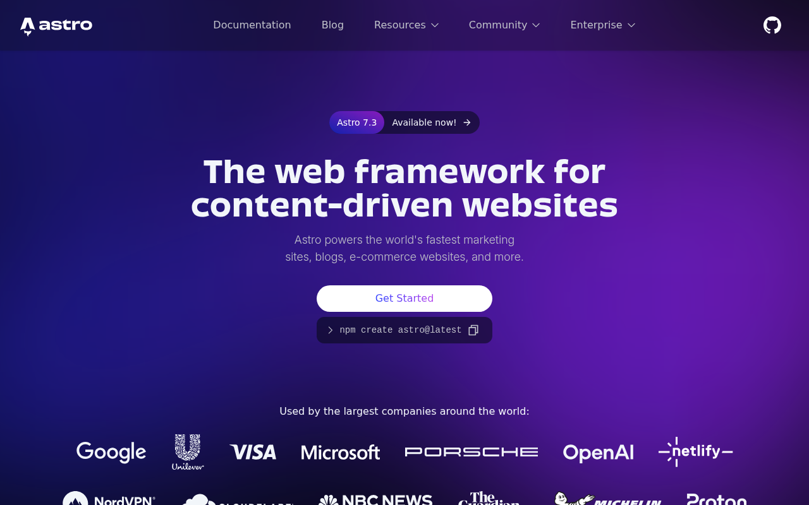

# chrome-browser

A [DeepSeek Harness](https://github.com/deepseek-ai/deepseek-harness) plugin that gives the model a
`chrome` tool: it drives the **Google Chrome installed on the machine** over the Chrome DevTools
Protocol, so front-end work can navigate, screenshot, inspect, and interact with real rendered pages.

The tool runs inside the Harness Host process, which has two consequences worth knowing:

- **No per-call approval.** A `chrome` call is an ordinary tool call; it never asks for shell or
  sandbox permission.
- **It is not affected by the shell sandbox.** On Linux, Chrome cannot start under a Landlock-confined
  shell (it aborts with `chrome_crashpad_handler: --database is required`), so a plain
  `google-chrome --headless …` bash command fails on a hardened Host. The Host process is not confined,
  and the plugin runs there.

Works on Linux, macOS, and Windows: the browser is located per platform, the sandbox flag follows the
platform, and Windows process-tree teardown uses `taskkill`.

Screenshots are returned as real images in the tool result (when the model route accepts image
input) **and** written to a file, so the model sees the rendered UI while a human can open the exact
PNG afterwards.

A real render, captured by the tool itself — [astro.build](https://astro.build/) at 1280×800:



## Tool reference

One tool, `chrome`, with an `action` parameter. Page ids (`p1`, `p2`, …) come from `open`; every
later action takes an optional `page` and otherwise uses the most recent one.

| Action | Key parameters | Result |
|---|---|---|
| `open` | `url`, `width`, `height`, `deviceScaleFactor`, `mobile` | Starts Chrome if needed, opens a page. |
| `goto` | `url`, `page` | Navigates an open page and waits for load. |
| `screenshot` | `path`, `fullPage`, `selector`, `width`, `height`, `scale` | PNG image + saved path; viewport by default. |
| `viewport` | `width`, `height`, `deviceScaleFactor`, `mobile` | Resizes the emulated viewport (responsive checks). |
| `dom` | `selector`, `maxChars` | `outerHTML` of the document or of one element. |
| `text` | `selector`, `maxChars` | `innerText` of the body or of one element. |
| `eval` | `expression`, `maxChars` | Evaluates JavaScript in the page, returns the JSON value. |
| `click` | `selector` or `x`/`y`, `button`, `clickCount` | Real mouse events at the element centre. |
| `type` | `selector`, `text`, `clear`, `submit`, `delayMs` | Focuses, clears, inserts real input events. |
| `press` | `key` | `Enter`, `Tab`, `Escape`, arrows, `Home`, `End`, `PageUp`, `PageDown`, `Backspace`, `Delete`, `Space`. |
| `wait_for` | `selector` or `text`, `timeoutMs` | Polls until the selector matches or the text appears. |
| `console` | `clear`, `limit` | Collected `console.*` calls, uncaught exceptions, browser log entries. |
| `network` | `clear`, `limit` | Failed requests and HTTP 4xx/5xx responses seen while attached. |
| `pdf` | `path` | Prints the page to a PDF file. |
| `tabs` | – | Lists open pages. |
| `close` | `page` | Closes one page. |
| `stop` | – | Terminates Chrome and removes its temporary profile. |

## Requirements

- Google Chrome or Chromium (any recent version; developed against Chrome 155), on Linux, macOS, or
  Windows. Chromium-based Microsoft Edge is accepted as a last resort on Windows.
- Node.js 22+ (uses the global `WebSocket`).
- No npm dependencies: the plugin imports only its sibling module and Node.js built-ins.
- For CJK pages install a CJK font (`apt-get install fonts-noto-cjk` on Debian/Ubuntu, or the Noto CJK
  fonts on Windows/macOS); without one, screenshots render those glyphs as empty boxes.

## Install into a Harness profile

The Host imports plugins only from its own module roots (the profile and the dsh installation), so the
bundle must be installed as a **real copy inside the profile**, not as a link to a checkout:

```bash
npm pack                    # -> local-dsh-chrome-browser-<version>.tgz
```

Then install that tarball through the Harness plugin manager (`plugin_manager`, `action:
install_bundle`, `target` = absolute tarball path). The Host reports `restart-required` when it
replaces an already installed package; restart `dsh web` to load the new module generation. A
version bump changes the dependency spec, which is what makes an update detectable.

## Configuration

The bundle patch sets these; `apply` merges them over its own defaults and validates them.

| Key | Default | Meaning |
|---|---|---|
| `chromePath` | `''` (auto-detect) | Browser executable. |
| `headless` | `true` | Run without a window. |
| `noSandbox` | `true` on POSIX, `false` on Windows | Pass `--no-sandbox`; required when the Host runs as root, unnecessary on Windows. |
| `userDataDir` | `''` (fresh temp dir per start) | Chrome profile directory; set it to a plain ASCII path if the system temp path upsets Chrome. |
| `defaultWidth` / `defaultHeight` | `1280` / `900` | Default viewport. |
| `maxOutputChars` | `100000` | Default cap for `dom`/`text`/`eval` output. |
| `navigationTimeoutMs` | `30000` | Navigation and `wait_for` budget. |
| `artifactDir` | `''` (system temp) | Where screenshots and PDFs go when no `path` is given. |

### How Chrome is located

The tool schema has **no path parameter**: the model never needs to know where the browser lives.
`resolveChromePath` resolves in this order and fails with an actionable message naming the config key
when nothing matches:

1. the row's `chromePath` config;
2. the `DSH_CHROME_PATH` environment variable;
3. the probe list for the running platform:
   - **Linux** — `/usr/bin/google-chrome`, `google-chrome-stable`, `google-chrome-beta`,
     `/usr/bin/chromium`, `chromium-browser`, `/opt/google/chrome/chrome`, `/snap/bin/chromium`,
     `/var/lib/flatpak/exports/bin/com.google.Chrome`;
   - **macOS** — `/Applications/Google Chrome.app/Contents/MacOS/Google Chrome`, the Chromium bundle,
     and the per-user `~/Applications` copy;
   - **Windows** — `%ProgramFiles%` and `%ProgramFiles(x86)%` `\Google\Chrome\Application\chrome.exe`,
     `%LOCALAPPDATA%\Google\Chrome\Application\chrome.exe`, then
     `%ProgramFiles(x86)%\Microsoft\Edge\Application\msedge.exe`.

For an unusual installation, set `DSH_CHROME_PATH` for the Host or edit the row's `chromePath` — no
code change is needed.

### Platform notes

| Platform | Behaviour |
|---|---|
| Linux | Chrome runs with `--no-sandbox` by default because the Host usually runs as root. A Landlock-confined shell cannot start Chrome at all (`chrome_crashpad_handler: --database is required`); the Host process is not confined, which is where this plugin runs. |
| macOS | Same code path as Linux apart from the probe list; `--no-sandbox` is likewise the default. |
| Windows | `--no-sandbox` is off by default, the process is spawned with `windowsHide` (no console window), and `stop`/disposal terminates the whole tree with `taskkill /pid <pid> /T /F` — Windows has no POSIX process groups, so a plain `child.kill()` would leave renderers and the crashpad handler behind. |

If Chrome exits before exposing a DevTools endpoint on Windows, the usual causes are a policy block on
`--remote-debugging-port`, antivirus interception, or a profile path the browser cannot use; set
`userDataDir` to a plain ASCII directory to rule out the last one.

## Tests

Two dependency-free suites drive real Chrome (no test framework required):

```bash
node test/engine.test.mjs   # CDP engine: browser resolution per platform, navigation, capture, input, console, network, teardown
node test/tool.test.mjs     # the real tool definition: schema validation, every action, error paths
```

Run them from the repository root; `tool.test.mjs` writes throwaway screenshots under `.tmp/`. Browser
resolution is injectable, so the Linux/macOS/Windows probe lists are covered even when the suite runs
on one of them.

## Operational notes

- Chrome starts lazily on the first action and runs with a fresh temporary profile; `stop` (or plugin
  disposal) terminates it and removes that profile. With `userDataDir` set, that directory is left in
  place instead.
- One Chrome process is shared by all pages, and all sessions share it.
- Captures beyond 12000 CSS px of page height are capped, and a clip capture that exceeds the
  deployment's image limits is retried once at half scale.
- If no attachment service or image-capable route is available, `screenshot` still saves the PNG and
  reports the path instead of attaching the image.

## License

MIT — see [LICENSE](LICENSE).
